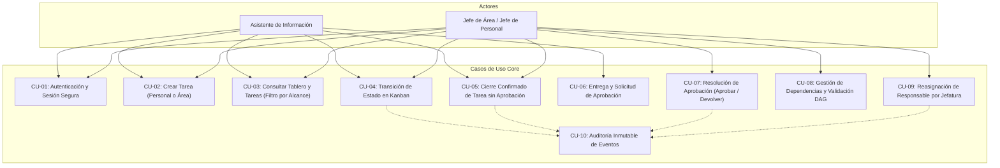
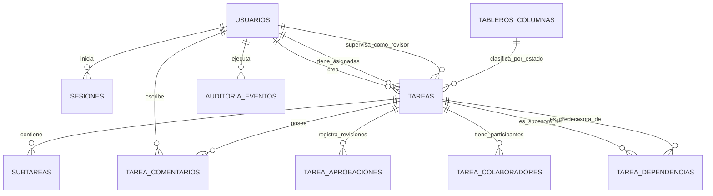

# Especificación Técnica: Casos de Uso, Modelo de Datos Relacional y Contratos de API REST — V1.2 (SETUP-04)

Este documento define la arquitectura técnica detallada para el backend PHP 8.2+ y la base de datos MySQL 8 / MariaDB (InnoDB) en DonWeb Ferozo, cubriendo los casos de uso nucleares, el diagrama entidad-relación, el script DDL SQL con integridad referencial y los contratos de endpoints de la API REST.

---

## 1. Casos de Uso Nucleares del Sistema



### Detalle de Casos de Uso Críticos

#### CU-02: Crear Tarea
- **Actores:** Asistente, Jefe.
- **Precondiciones:** Sesión válida y activa.
- **Flujo Principal (Asistente):**
  1. El asistente envía datos de la tarea (título, descripción, prioridad, fecha límite, subtareas).
  2. Si `tipo_tarea = PERSONAL`: la tarea es privada, `responsable_id` se fuerza al ID del asistente autenticado.
  3. Si `tipo_tarea = AREA`: el backend valida que el asistente posea permiso de creación. El campo `responsable_id` se fuerza obligatoriamente al ID del asistente autenticado (**RF-05, RN-03**). Cualquier intento de enviar otro `responsable_id` es rechazado con `403 Forbidden`.
  4. Se crea la tarea con estado inicial `PENDIENTE` (o `BLOQUEADA` si se definieron dependencias no resueltas).
- **Flujo Alterno (Jefe):**
  1. El jefe puede asignar `responsable_id` a sí mismo o a cualquiera de los asistentes autorizados del área (**RF-06, RN-04**).
  2. El jefe puede configurar si la tarea `requiere_aprobacion = true` y designar el `revisor_id`.

#### CU-05: Cierre Confirmado de Tarea sin Aprobación
- **Actores:** Responsable de la tarea, Jefe.
- **Precondiciones:** Tarea con `requiere_aprobacion = false`, en estado `EN_PROCESO`.
- **Regla de Negocio (RN-11, RN-12):**
  1. La petición debe incluir el flag explícito `confirmacion_cierre: true`.
  2. Si `confirmacion_cierre = false` o no está presente, la API retorna error `422 Unprocessable Entity` y el estado permanece intacto.
  3. Al confirmar: en una **transacción atómica (ACID)** se actualiza la tarea a `FINALIZADA`, se registra la fecha de finalización, se guarda el evento en `auditoria_eventos` y se invoca el algoritmo de evaluación de dependencias sucesoras en el DAG.

#### CU-07: Resolución de Aprobación
- **Actores:** Jefe / Revisor asignado.
- **Precondiciones:** Tarea en estado `EN_REVISION` con registro de aprobación en estado `PENDIENTE`.
- **Flujo APROBAR:**
  1. Se actualiza el registro de aprobación a `APROBADA`.
  2. La tarea transiciona atómicamente a `FINALIZADA`.
  3. Se evalúan y desbloquean las tareas dependientes sucesoras.
  4. Se registra en auditoría.
- **Flujo DEVOLVER:**
  1. El revisor envía obligatoriamente `observaciones_devolucion` (texto no vacío).
  2. El registro de aprobación pasa a `DEVUELTA`.
  3. La tarea regresa atómicamente a `EN_PROCESO` (**RN-10**).
  4. Las tareas sucesoras continúan bloqueadas.

---

## 2. Diagrama Entidad-Relación (ERD)



---

## 3. Diccionario y Estructura DDL SQL (MySQL 8 / InnoDB)

Diseñado para ejecutarse directamente en MySQL 8 o MariaDB a través del panel Ferozo (phpMyAdmin o scripts de migración). Utiliza motor `InnoDB` para garantizar transacciones ACID y bloqueo a nivel de fila (`SELECT ... FOR UPDATE`).

```sql
-- =============================================================================
-- SISTEMA DE TAREAS - ÁREA DE PLANEAMIENTO
-- Script DDL para MySQL 8 / MariaDB (InnoDB, UTF8mb4)
-- =============================================================================

SET NAMES utf8mb4;
SET FOREIGN_KEY_CHECKS = 0;

-- -----------------------------------------------------------------------------
-- 1. Tabla: usuarios
-- -----------------------------------------------------------------------------
CREATE TABLE IF NOT EXISTS `usuarios` (
  `id` INT UNSIGNED NOT NULL AUTO_INCREMENT,
  `codigo` VARCHAR(20) NOT NULL UNIQUE,           -- Ej: 'ASIST-01', 'JEFE-PLAN'
  `nombre` VARCHAR(100) NOT NULL,
  `email` VARCHAR(120) NOT NULL UNIQUE,
  `password_hash` VARCHAR(255) NOT NULL,          -- password_hash() Bcrypt/Argon2id
  `rol` ENUM('ASISTENTE', 'JEFE_PERSONAL', 'JEFE_PLANEAMIENTO') NOT NULL,
  `cargo` VARCHAR(100) NOT NULL,
  `activo` TINYINT(1) NOT NULL DEFAULT 1,
  `created_at` DATETIME NOT NULL DEFAULT CURRENT_TIMESTAMP,
  `updated_at` DATETIME NOT NULL DEFAULT CURRENT_TIMESTAMP ON UPDATE CURRENT_TIMESTAMP,
  PRIMARY KEY (`id`),
  INDEX `idx_usuarios_rol` (`rol`),
  INDEX `idx_usuarios_activo` (`activo`)
) ENGINE=InnoDB DEFAULT CHARSET=utf8mb4 COLLATE=utf8mb4_unicode_ci;

-- -----------------------------------------------------------------------------
-- 2. Tabla: sesiones
-- -----------------------------------------------------------------------------
CREATE TABLE IF NOT EXISTS `sesiones` (
  `id` INT UNSIGNED NOT NULL AUTO_INCREMENT,
  `usuario_id` INT UNSIGNED NOT NULL,
  `token_hash` VARCHAR(64) NOT NULL UNIQUE,       -- SHA-256 del token de sesión
  `ip_address` VARCHAR(45) NULL,
  `user_agent` VARCHAR(255) NULL,
  `expira_at` DATETIME NOT NULL,
  `created_at` DATETIME NOT NULL DEFAULT CURRENT_TIMESTAMP,
  PRIMARY KEY (`id`),
  CONSTRAINT `fk_sesiones_usuario` FOREIGN KEY (`usuario_id`) REFERENCES `usuarios` (`id`) ON DELETE CASCADE,
  INDEX `idx_sesiones_token` (`token_hash`),
  INDEX `idx_sesiones_expira` (`expira_at`)
) ENGINE=InnoDB DEFAULT CHARSET=utf8mb4 COLLATE=utf8mb4_unicode_ci;

-- -----------------------------------------------------------------------------
-- 3. Tabla: tableros_columnas (Estados funcionales del Kanban)
-- -----------------------------------------------------------------------------
CREATE TABLE IF NOT EXISTS `tableros_columnas` (
  `id` INT UNSIGNED NOT NULL AUTO_INCREMENT,
  `nombre` VARCHAR(50) NOT NULL,                  -- Nombre visual editable
  `orden` SMALLINT UNSIGNED NOT NULL DEFAULT 1,
  `tipo_estado` ENUM('PENDIENTE', 'EN_PROCESO', 'BLOQUEADA', 'EN_REVISION', 'FINALIZADA') NOT NULL,
  `color_hex` VARCHAR(7) NOT NULL DEFAULT '#64748b',
  `activo` TINYINT(1) NOT NULL DEFAULT 1,
  `created_at` DATETIME NOT NULL DEFAULT CURRENT_TIMESTAMP,
  PRIMARY KEY (`id`),
  INDEX `idx_columnas_tipo_estado` (`tipo_estado`),
  INDEX `idx_columnas_orden` (`orden`)
) ENGINE=InnoDB DEFAULT CHARSET=utf8mb4 COLLATE=utf8mb4_unicode_ci;

-- -----------------------------------------------------------------------------
-- 4. Tabla: tareas
-- -----------------------------------------------------------------------------
CREATE TABLE IF NOT EXISTS `tareas` (
  `id` INT UNSIGNED NOT NULL AUTO_INCREMENT,
  `codigo` VARCHAR(30) NOT NULL UNIQUE,           -- Ej: 'TAR-2026-0001'
  `titulo` VARCHAR(255) NOT NULL,
  `descripcion` TEXT NULL,
  `tipo_tarea` ENUM('PERSONAL', 'AREA') NOT NULL DEFAULT 'AREA',
  `columna_id` INT UNSIGNED NOT NULL,             -- FK al estado actual
  `prioridad` ENUM('BAJA', 'MEDIA', 'ALTA', 'URGENTE') NOT NULL DEFAULT 'MEDIA',
  `creador_id` INT UNSIGNED NOT NULL,
  `responsable_id` INT UNSIGNED NOT NULL,
  `requiere_aprobacion` TINYINT(1) NOT NULL DEFAULT 0,
  `revisor_id` INT UNSIGNED NULL,                 -- Revisor asignado si requiere aprobación
  `fecha_limite` DATE NULL,
  `fecha_finalizada` DATETIME NULL,
  `created_at` DATETIME NOT NULL DEFAULT CURRENT_TIMESTAMP,
  `updated_at` DATETIME NOT NULL DEFAULT CURRENT_TIMESTAMP ON UPDATE CURRENT_TIMESTAMP,
  PRIMARY KEY (`id`),
  CONSTRAINT `fk_tareas_columna` FOREIGN KEY (`columna_id`) REFERENCES `tableros_columnas` (`id`),
  CONSTRAINT `fk_tareas_creador` FOREIGN KEY (`creador_id`) REFERENCES `usuarios` (`id`),
  CONSTRAINT `fk_tareas_responsable` FOREIGN KEY (`responsable_id`) REFERENCES `usuarios` (`id`),
  CONSTRAINT `fk_tareas_revisor` FOREIGN KEY (`revisor_id`) REFERENCES `usuarios` (`id`) ON DELETE SET NULL,
  INDEX `idx_tareas_tipo_resp` (`tipo_tarea`, `responsable_id`),
  INDEX `idx_tareas_columna` (`columna_id`),
  INDEX `idx_tareas_prioridad` (`prioridad`),
  INDEX `idx_tareas_fecha_limite` (`fecha_limite`)
) ENGINE=InnoDB DEFAULT CHARSET=utf8mb4 COLLATE=utf8mb4_unicode_ci;

-- -----------------------------------------------------------------------------
-- 5. Tabla: subtareas
-- -----------------------------------------------------------------------------
CREATE TABLE IF NOT EXISTS `subtareas` (
  `id` INT UNSIGNED NOT NULL AUTO_INCREMENT,
  `tarea_id` INT UNSIGNED NOT NULL,
  `titulo` VARCHAR(255) NOT NULL,
  `completada` TINYINT(1) NOT NULL DEFAULT 0,
  `orden` SMALLINT UNSIGNED NOT NULL DEFAULT 1,
  `created_at` DATETIME NOT NULL DEFAULT CURRENT_TIMESTAMP,
  `updated_at` DATETIME NOT NULL DEFAULT CURRENT_TIMESTAMP ON UPDATE CURRENT_TIMESTAMP,
  PRIMARY KEY (`id`),
  CONSTRAINT `fk_subtareas_tarea` FOREIGN KEY (`tarea_id`) REFERENCES `tareas` (`id`) ON DELETE CASCADE,
  INDEX `idx_subtareas_tarea` (`tarea_id`, `orden`)
) ENGINE=InnoDB DEFAULT CHARSET=utf8mb4 COLLATE=utf8mb4_unicode_ci;

-- -----------------------------------------------------------------------------
-- 6. Tabla: tarea_dependencias (Grafo Acíclico Dirigido - DAG)
-- -----------------------------------------------------------------------------
CREATE TABLE IF NOT EXISTS `tarea_dependencias` (
  `id` INT UNSIGNED NOT NULL AUTO_INCREMENT,
  `tarea_id` INT UNSIGNED NOT NULL,               -- Tarea sucesora (dependiente)
  `predecesora_id` INT UNSIGNED NOT NULL,         -- Tarea predecesora (debe finalizar antes)
  `tipo_dependencia` ENUM('AND_FINISH_TO_START') NOT NULL DEFAULT 'AND_FINISH_TO_START',
  `created_at` DATETIME NOT NULL DEFAULT CURRENT_TIMESTAMP,
  PRIMARY KEY (`id`),
  UNIQUE KEY `uk_tarea_predecesora` (`tarea_id`, `predecesora_id`),
  CONSTRAINT `fk_dep_tarea_sucesora` FOREIGN KEY (`tarea_id`) REFERENCES `tareas` (`id`) ON DELETE CASCADE,
  CONSTRAINT `fk_dep_tarea_predecesora` FOREIGN KEY (`predecesora_id`) REFERENCES `tareas` (`id`) ON DELETE CASCADE,
  INDEX `idx_dep_predecesora` (`predecesora_id`)
) ENGINE=InnoDB DEFAULT CHARSET=utf8mb4 COLLATE=utf8mb4_unicode_ci;

-- -----------------------------------------------------------------------------
-- 7. Tabla: tarea_aprobaciones
-- -----------------------------------------------------------------------------
CREATE TABLE IF NOT EXISTS `tarea_aprobaciones` (
  `id` INT UNSIGNED NOT NULL AUTO_INCREMENT,
  `tarea_id` INT UNSIGNED NOT NULL,
  `revisor_id` INT UNSIGNED NOT NULL,
  `estado` ENUM('PENDIENTE', 'APROBADA', 'DEVUELTA') NOT NULL DEFAULT 'PENDIENTE',
  `comentario_entrega` TEXT NULL,
  `observaciones_devolucion` TEXT NULL,
  `fecha_solicitud` DATETIME NOT NULL DEFAULT CURRENT_TIMESTAMP,
  `fecha_resolucion` DATETIME NULL,
  PRIMARY KEY (`id`),
  CONSTRAINT `fk_aprob_tarea` FOREIGN KEY (`tarea_id`) REFERENCES `tareas` (`id`) ON DELETE CASCADE,
  CONSTRAINT `fk_aprob_revisor` FOREIGN KEY (`revisor_id`) REFERENCES `usuarios` (`id`),
  INDEX `idx_aprob_tarea_estado` (`tarea_id`, `estado`),
  INDEX `idx_aprob_revisor_estado` (`revisor_id`, `estado`)
) ENGINE=InnoDB DEFAULT CHARSET=utf8mb4 COLLATE=utf8mb4_unicode_ci;

-- -----------------------------------------------------------------------------
-- 8. Tabla: tarea_comentarios (Comentarios y Evidencias de Entrega)
-- -----------------------------------------------------------------------------
CREATE TABLE IF NOT EXISTS `tarea_comentarios` (
  `id` INT UNSIGNED NOT NULL AUTO_INCREMENT,
  `tarea_id` INT UNSIGNED NOT NULL,
  `usuario_id` INT UNSIGNED NOT NULL,
  `comentario` TEXT NOT NULL,
  `es_evidencia` TINYINT(1) NOT NULL DEFAULT 0,
  `archivo_nombre_original` VARCHAR(255) NULL,
  `archivo_ruta_hash` VARCHAR(255) NULL,          -- Nombre protegido en disco
  `archivo_mime` VARCHAR(100) NULL,
  `archivo_size_bytes` INT UNSIGNED NULL,
  `created_at` DATETIME NOT NULL DEFAULT CURRENT_TIMESTAMP,
  PRIMARY KEY (`id`),
  CONSTRAINT `fk_coment_tarea` FOREIGN KEY (`tarea_id`) REFERENCES `tareas` (`id`) ON DELETE CASCADE,
  CONSTRAINT `fk_coment_usuario` FOREIGN KEY (`usuario_id`) REFERENCES `usuarios` (`id`),
  INDEX `idx_coment_tarea` (`tarea_id`, `created_at`)
) ENGINE=InnoDB DEFAULT CHARSET=utf8mb4 COLLATE=utf8mb4_unicode_ci;

-- -----------------------------------------------------------------------------
-- 9. Tabla: tarea_colaboradores
-- -----------------------------------------------------------------------------
CREATE TABLE IF NOT EXISTS `tarea_colaboradores` (
  `id` INT UNSIGNED NOT NULL AUTO_INCREMENT,
  `tarea_id` INT UNSIGNED NOT NULL,
  `usuario_id` INT UNSIGNED NOT NULL,
  `created_at` DATETIME NOT NULL DEFAULT CURRENT_TIMESTAMP,
  PRIMARY KEY (`id`),
  UNIQUE KEY `uk_tarea_colaborador` (`tarea_id`, `usuario_id`),
  CONSTRAINT `fk_colab_tarea` FOREIGN KEY (`tarea_id`) REFERENCES `tareas` (`id`) ON DELETE CASCADE,
  CONSTRAINT `fk_colab_usuario` FOREIGN KEY (`usuario_id`) REFERENCES `usuarios` (`id`) ON DELETE CASCADE
) ENGINE=InnoDB DEFAULT CHARSET=utf8mb4 COLLATE=utf8mb4_unicode_ci;

-- -----------------------------------------------------------------------------
-- 10. Tabla: auditoria_eventos (Historial inmutable de trazabilidad)
-- -----------------------------------------------------------------------------
CREATE TABLE IF NOT EXISTS `auditoria_eventos` (
  `id` BIGINT UNSIGNED NOT NULL AUTO_INCREMENT,
  `usuario_id` INT UNSIGNED NULL,                 -- NULL si es evento automático del sistema
  `entidad_tipo` ENUM('TAREA', 'SUBTAREA', 'DEPENDENCIA', 'APROBACION', 'AUTH') NOT NULL,
  `entidad_id` INT UNSIGNED NOT NULL,
  `accion` VARCHAR(50) NOT NULL,                  -- 'CREAR', 'TRANSICION_ESTADO', 'CIERRE_CONFIRMADO', 'APROBAR', 'DEVOLVER', etc.
  `estado_anterior` VARCHAR(50) NULL,
  `estado_nuevo` VARCHAR(50) NULL,
  `detalles_json` JSON NULL,                      -- Registro de cambios específicos
  `ip_address` VARCHAR(45) NULL,
  `created_at` DATETIME NOT NULL DEFAULT CURRENT_TIMESTAMP,
  PRIMARY KEY (`id`),
  INDEX `idx_auditoria_entidad` (`entidad_tipo`, `entidad_id`),
  INDEX `idx_auditoria_usuario` (`usuario_id`),
  INDEX `idx_auditoria_fecha` (`created_at`)
) ENGINE=InnoDB DEFAULT CHARSET=utf8mb4 COLLATE=utf8mb4_unicode_ci;

SET FOREIGN_KEY_CHECKS = 1;
```

---

## 4. Algoritmos de Grafo y Automatización (Backend PHP)

### 4.1 Prevención de Ciclos en el DAG (`hasCycle`)
Antes de insertar un registro en `tarea_dependencias` (`tarea_id -> predecesora_id`), el backend ejecuta una búsqueda en profundidad (DFS). Si la nueva arista crea un camino desde `tarea_id` hasta `predecesora_id`, se rechaza con error `409 Conflict: La dependencia formaría un ciclo en el grafo`.

```php
function checkCycle(PDO $db, int $targetId, int $sourceId): bool {
    // Si la predecesora es la misma tarea -> ciclo trivial
    if ($targetId === $sourceId) return true;

    // Cola BFS o DFS para verificar si targetId ya es predecesora de sourceId
    $visited = [];
    $queue = [$sourceId];

    while (!empty($queue)) {
        $current = array_shift($queue);
        if ($current === $targetId) return true;
        $visited[$current] = true;

        $stmt = $db->prepare("SELECT predecesora_id FROM tarea_dependencias WHERE tarea_id = ?");
        $stmt->execute([$current]);
        $preds = $stmt->fetchAll(PDO::FETCH_COLUMN);

        foreach ($preds as $p) {
            if (!isset($visited[$p])) {
                $queue[] = (int)$p;
            }
        }
    }
    return false;
}
```

### 4.2 Desbloqueo Atómico de Sucesores (Regla AND)
Cuando una tarea $T$ pasa a `FINALIZADA` (sea por confirmación directa o por aprobación), dentro de la misma transacción:

```sql
-- 1. Buscar todas las tareas sucesoras directas de T que estén en estado BLOQUEADA
SELECT s.id, s.codigo, s.titulo
FROM tareas s
INNER JOIN tableros_columnas c ON s.columna_id = c.id
INNER JOIN tarea_dependencias d ON d.tarea_id = s.id
WHERE d.predecesora_id = :tarea_finalizada_id
  AND c.tipo_estado = 'BLOQUEADA'
FOR UPDATE;

-- 2. Para cada sucesora, verificar si TODAS sus predecesoras están FINALIZADAS
SELECT COUNT(*) as predecesoras_incompletas
FROM tarea_dependencias td
INNER JOIN tareas p ON td.predecesora_id = p.id
INNER JOIN tableros_columnas pc ON p.columna_id = pc.id
WHERE td.tarea_id = :sucesora_id
  AND pc.tipo_estado != 'FINALIZADA';

-- 3. Si predecesoras_incompletas == 0:
-- Desbloquear pasando la sucesora a PENDIENTE
UPDATE tareas 
SET columna_id = (SELECT id FROM tableros_columnas WHERE tipo_estado = 'PENDIENTE' LIMIT 1)
WHERE id = :sucesora_id;
```

---

## 5. Contratos de la API REST (Especificación de Endpoints)

Todas las respuestas utilizan un envoltorio estándar JSON (*Response Envelope*):

```json
{
  "success": true,
  "data": { ... },
  "error": null,
  "meta": {
    "timestamp": "2026-10-13T16:20:00Z"
  }
}
```

En caso de error:
```json
{
  "success": false,
  "data": null,
  "error": {
    "code": "ERR_FORBIDDEN_ASSIGNMENT",
    "message": "Los asistentes únicamente pueden asignarse tareas a sí mismos."
  },
  "meta": {
    "timestamp": "2026-10-13T16:20:00Z"
  }
}
```

### Catálogo de Endpoints

| Método | Endpoint | Roles Permitidos | Propósito |
| :--- | :--- | :--- | :--- |
| `POST` | `/api/auth/login` | Público | Autenticación con email y contraseña. Retorna cookie de sesión `HttpOnly`. |
| `POST` | `/api/auth/logout` | Autenticado | Invalida el token en base de datos y destruye la cookie. |
| `GET`  | `/api/auth/me` | Autenticado | Retorna el perfil y rol del usuario en sesión. |
| `GET`  | `/api/tableros/columnas` | Autenticado | Retorna las columnas y estados del tablero Kanban. |
| `GET`  | `/api/tareas` | Autenticado | Lista tareas con filtros (`tipo`, `columna_id`, `prioridad`, `responsable_id`). **Backend aplica filtro por alcance:** asistente solo recibe sus propias tareas oficiales o personales. |
| `GET`  | `/api/tareas/{id}` | Autenticado | Detalle completo de la tarea. **Aplica validación de ID:** si es tarea de otro asistente, retorna `403 Forbidden` (**RF-07**). |
| `POST` | `/api/tareas` | Autenticado | Crea tarea. Si el usuario es asistente, fuerza `responsable_id = me`. Si intenta asignar a otro, retorna `403 Forbidden` (**RF-05**). |
| `PUT`  | `/api/tareas/{id}` | Autenticado | Actualiza datos de la tarea. Asistente no puede alterar el campo `responsable_id`. |
| `POST` | `/api/tareas/{id}/transicion` | Autenticado | Mueve la tarea entre columnas/estados. |
| `POST` | `/api/tareas/{id}/solicitar-aprobacion` | Asistente/Jefe | Envía tarea a `EN_REVISION` adjuntando evidencias y comentarios. |
| `POST` | `/api/tareas/{id}/resolver-aprobacion` | Jefes | Aprueba o devuelve la tarea con observaciones (**RF-13, RN-10**). |
| `GET`  | `/api/aprobaciones/pendientes` | Jefes | Lista tareas en revisión que esperan resolución del jefe. |
| `POST` | `/api/tareas/{id}/dependencias` | Jefes/Creador | Agrega una predecesora a la tarea previa comprobación de DAG sin ciclos. |
| `DELETE`| `/api/tareas/{id}/dependencias/{pred_id}` | Jefes/Creador | Elimina una relación de precedencia. |
| `POST` | `/api/tareas/{id}/subtareas` | Responsable/Jefe | Crea subtarea dentro de la tarea. |
| `PATCH`| `/api/subtareas/{id}` | Responsable/Jefe | Marca subtarea como completada o pendiente. |
| `POST` | `/api/tareas/{id}/comentarios` | Autenticado | Registra comentario o evidencia (con soporte de archivo seguro). |
| `GET`  | `/api/tareas/{id}/auditoria` | Jefes | Retorna la bitácora inmutable de eventos de la tarea (**RF-18**). |

---

### Detalle de Endpoints Clave

#### `POST /api/tareas/{id}/transicion`
- **Headers:** `Content-Type: application/json`
- **Request Body:**
```json
{
  "nueva_columna_id": 5,
  "confirmacion_cierre": true
}
```
- **Lógica de Validación:**
  1. Si `columna_destino.tipo_estado == 'FINALIZADA'`:
     - Si la tarea tiene `requiere_aprobacion == true`: Rechazar con `409 Conflict: Esta tarea exige aprobación previa. Debe solicitar revisión.`
     - Si la tarea tiene `requiere_aprobacion == false`: Requiere `confirmacion_cierre == true`. Si es `false`, responder `422 Unprocessable Entity: Se requiere confirmación explícita de cierre.`
  2. Si pasa las validaciones: Iniciar transacción `BEGIN`, actualizar `columna_id`, registrar en auditoría, evaluar desbloqueo de dependientes y ejecutar `COMMIT`.

#### `POST /api/tareas/{id}/resolver-aprobacion`
- **Headers:** `Content-Type: application/json`
- **Request Body (Aprobación):**
```json
{
  "accion": "APROBAR"
}
```
- **Request Body (Devolución):**
```json
{
  "accion": "DEVOLVER",
  "observaciones": "Se detectaron incongruencias en la conciliación de mermas. Corregir y reenviar."
}
```
- **Respuestas:**
  - `200 OK`: Transición procesada exitosamente.
  - `400 Bad Request`: Acción inválida o falta `observaciones` al devolver.
  - `403 Forbidden`: El usuario no posee rol de jefatura ni es el revisor asignado.
